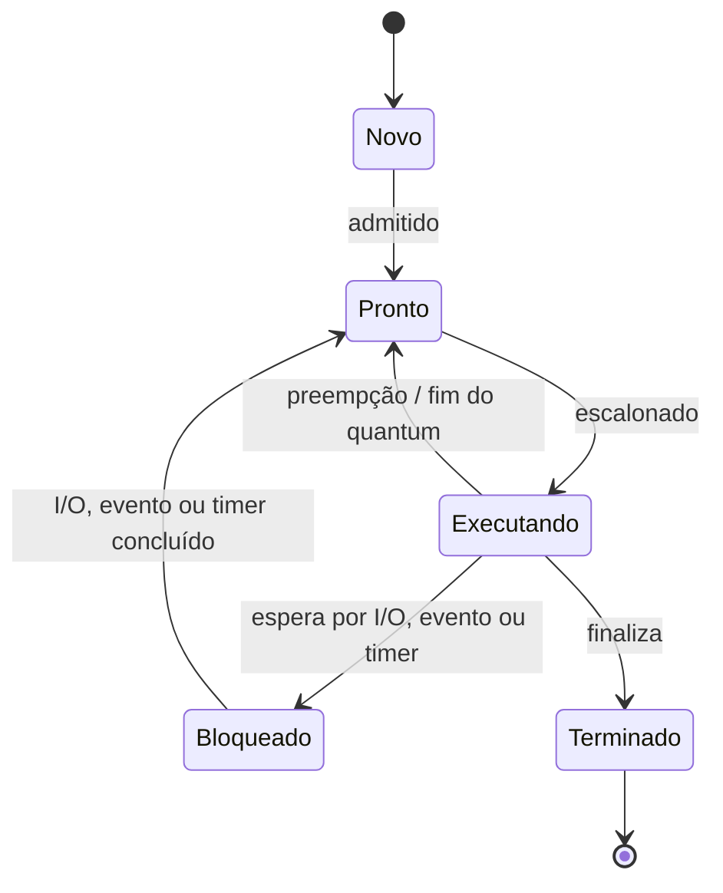
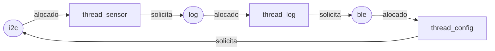

# Sarah Araujo Duarte — D1 = 5; D2 = 7; N = 5

Contagem individual: `Sarah` tem 5 letras, então **D1 = 5**. `Sarah` (5) + `Araujo` (6) + `Duarte` (6) = 17 letras; logo, **D2 = 7**. Assim, **N = 3 + (7 mod 5) = 5**.

# Parte A — O problema técnico

## A1. Arquitetura e memória: qual processador vai na pulseira?

### Parâmetros individuais

Quantidade de instruções por amostra:

\[
IC = 100.000 + 20.000 \times D2
   = 100.000 + 20.000 \times 7
   = 240.000\ \text{instruções}
\]

Taxa de falta da cache L1 da Plataforma V:

\[
m = 3\% + 0,5\% \times D1
  = 3\% + 0,5\% \times 5
  = 5,5\% = 0,055
\]

### Plataforma H

O tempo de CPU é dado por `instruções × CPI / clock`:

\[
T_H = \frac{240.000 \times 1,5}{48.000.000}
    = 0,0075\ \text{s}
    = 7,5\ \text{ms}
\]

**Conclusão:** a Plataforma H sem acelerador **não atende** ao limite de 5 ms; ela o excede em 2,5 ms.

### Plataforma V

Considerando um ciclo no acerto e penalidade de 120 ciclos por falta, o tempo médio de acesso à memória (AMAT) é:

\[
AMAT = 1 + m \times 120
     = 1 + 0,055 \times 120
     = 7,6\ \text{ciclos por acesso}
\]

Pela fórmula fornecida no enunciado:

\[
CPI_{efetivo} = 1,0 + (1,3 \times m \times 120)
              = 1,0 + (1,3 \times 0,055 \times 120)
              = 1,0 + 8,58
              = 9,58
\]

Tempo médio por amostra:

\[
T_V = \frac{240.000 \times 9,58}{1.200.000.000}
    = 0,001916\ \text{s}
    = 1,916\ \text{ms}
\]

No pior caso, soma-se a interrupção de até 3 ms do Linux:

\[
T_{V,pior} = 1,916 + 3 = 4,916\ \text{ms}
\]

**Conclusão:** a Plataforma V atende matematicamente aos 5 ms, mas sobra uma margem de apenas `5 − 4,916 = 0,084 ms` (84 µs). Essa margem é arriscada para um requisito de segurança.

### Plataforma H com DSP e Lei de Amdahl

O filtro representa 60% do tempo e é acelerado cinco vezes. O speedup global é:

\[
S = \frac{1}{(1-p)+\frac{p}{s}}
  = \frac{1}{(1-0,60)+\frac{0,60}{5}}
  = \frac{1}{0,40+0,12}
  = \frac{1}{0,52}
  \approx 1,923
\]

O novo tempo é:

\[
T_{H,DSP} = \frac{7,5}{1,923}
          = 3,9\ \text{ms}
\]

Outra forma de conferir é separar a parte não acelerada da acelerada: `7,5 × (0,40 + 0,60/5) = 3,9 ms`.

**Conclusão:** a Plataforma H com DSP **atende** ao requisito, com margem de 1,1 ms.

### Por que V precisa de cache e H funciona sem?

A Plataforma V compartilha o caminho para as instruções e dados e usa DRAM muito mais lenta que o processador. Sem cache, o gargalo de Von Neumann faria a CPU esperar a memória com frequência. A cache mantém instruções e os dados recentes próximos da CPU. Já a H separa instruções e dados e usa SRAM interna de um ciclo, compatível com seu clock menor. Por conta disso, ela não depende de cache para esconder a latência da memória.

### Evidência da máquina


A máquina possui L1 de dados (`L1d`, 352 KiB) separada da L1 de instruções (`L1i`, 576 KiB). Para o software, o x86-64 mantém um único espaço de endereçamento, característica de Von Neumann; internamente, porém, a L1 separada usa uma **Harvard modificada** para buscar instruções e acessar dados em paralelo. Logo, não é uma arquitetura Harvard pura.

## A2. Pipeline: o loop do filtro

### Dependências RAW

| Consumidora | Produtora | Registrador | Motivo |
|---|---|---:|---|
| I2 `add x6,x6,x5` | I1 `lw x5,0(x10)` | `x5` | I2 usa a amostra carregada por I1. |
| I4 `sub x6,x6,x7` | I2 `add x6,x6,x5` | `x6` | I4 usa a soma atualizada por I2. |
| I4 `sub x6,x6,x7` | I3 `lw x7,0(x11)` | `x7` | I4 usa a amostra antiga carregada por I3. |
| I5 `sw x6,0(x12)` | I4 `sub x6,x6,x7` | `x6` | I5 grava a soma produzida por I4. |

Essas são dependências verdadeiras de leitura após escrita (RAW). O uso inicial de `x6` por I2 vem de uma iteração anterior e, portanto, não cria uma nova dependência dentro deste trecho.

### Sem forwarding

`ID*` ou `IF*` indica que a instrução ficou retida naquele estágio por uma bolha. Como o registrador é escrito na primeira metade do ciclo e lido na segunda, uma consumidora pode terminar seu ID no mesmo ciclo do WB da produtora.

```text
Ciclo  01  02  03  04  05  06  07  08  09  10  11  12  13  14  15  16  17
I1     IF  ID  EX  MEM WB
I2         IF  ID  ID* ID* EX  MEM WB
I3             IF  IF* IF* ID  EX  MEM WB
I4                         IF  ID  ID* ID* EX  MEM WB
I5                             IF  IF* IF* ID  ID* ID* EX  MEM WB
I6                                         IF  IF* IF* ID  EX  MEM WB
I7                                                     IF  ID  EX  MEM WB
```

I2 precisa esperar o WB de I1; I4 espera o WB de I3 (e, até então, I2 já escreveu `x6`); I5 espera o WB de I4. O trecho leva **17 ciclos**, do primeiro IF ao último WB.

### Com forwarding

```text
Ciclo  01  02  03  04  05  06  07  08  09  10  11  12  13
I1     IF  ID  EX  MEM WB
I2         IF  ID  ID* EX  MEM WB
I3             IF  IF* ID  EX  MEM WB
I4                     IF  ID  ID* EX  MEM WB
I5                         IF  IF* ID  EX  MEM WB
I6                                 IF  ID  EX  MEM WB
I7                                     IF  ID  EX  MEM WB
```

O forwarding resolve as dependências entre operações aritméticas e também encaminha o dado a ser armazenado pelo `sw`. Restam duas bolhas de **load-use**: I1→I2 por `x5` e I3→I4 por `x7`. O valor de um `lw` só fica disponível ao final de MEM, tarde demais para a EX da instrução imediatamente seguinte. O trecho leva **13 ciclos**.

### Reordenação sem bolhas com forwarding

Uma ordem válida, preservando endereços e resultado, é:

```asm
1  lw   x5, 0(x10)     # lê a amostra nova
2  lw   x7, 0(x11)     # lê a amostra antiga enquanto x5 não está pronto
3  addi x10, x10, 4    # trabalho independente
4  add  x6, x6, x5     # soma += nova
5  addi x11, x11, 4    # separa add e sub; carga de x7 já terminou
6  sub  x6, x6, x7     # soma -= antiga
7  sw   x6, 0(x12)     # recebe x6 por forwarding
```

```text
Ciclo  01  02  03  04  05  06  07  08  09  10  11
J1     IF  ID  EX  MEM WB
J2         IF  ID  EX  MEM WB
J3             IF  ID  EX  MEM WB
J4                 IF  ID  EX  MEM WB
J5                     IF  ID  EX  MEM WB
J6                         IF  ID  EX  MEM WB
J7                             IF  ID  EX  MEM WB
```

Não há bolhas: o total é o mínimo ideal de `7 + 4 = 11 ciclos`.

## A3. Processos e threads: como organizar o software

### Proposta

Eu criaria um **processo principal de tempo crítico** com três threads: sensor, processamento e motor. Elas formam um pipeline curto, precisam trocar cada amostra com baixa latência e podem compartilhar buffers em memória. Threads têm criação e troca de contexto mais baratas que processos, embora o buffer compartilhado exija sincronização.

O BLE ficaria em um **processo separado**, com privilégios mínimos. A comunicação com o processo principal seria feita por uma fila IPC limitada: o processo principal envia cópias dos logs e recebe somente comandos validados. A troca por IPC tem algum custo, mas o BLE não está no caminho sensor→processamento→motor e não deve bloquear esse caminho.

Se o BLE vulnerável fosse uma thread, uma exploração teria acesso à mesma memória, aos buffers e aos ponteiros do processo principal; um crash também derrubaria todas as threads. Como processo separado, o sistema operacional fornece espaço de endereçamento e permissões próprios: uma falha pode encerrar ou comprometer o BLE sem necessariamente parar a vibração. Isso reduz o impacto, embora não elimine a necessidade de validar as mensagens IPC.

### Estados de um processo



A thread do sensor passa a maior parte do tempo **bloqueada/esperando**, pois há uma amostra somente a cada 10 ms. Ela aguarda o timer ou a interrupção do sensor, é acordada, lê rapidamente a amostra e volta a esperar; espera bloqueada é preferível a desperdiçar CPU em espera ocupada.

## A4. Código com semáforos: o buffer entre o sensor e o motor

O parâmetro individual é:

\[
N = 3 + (D2 \bmod 5) = 3 + (7 \bmod 5) = 3 + 2 = 5
\]

O código está em [`codigo/`](codigo/). Cada versão foi executada três vezes com 20.000 amostras. “Consumidas” conta leituras válidas; “perdidas” conta IDs esperados que nunca chegaram; “duplicadas” conta ocorrências válidas além da primeira.

| Versão | Execução | Consumidas | Perdidas | Duplicadas | Travou? |
|---|---:|---:|---:|---:|:---:|
| 1 — sem sincronização | 1 | 17.901 | 2.099 | 0 | Não |
| 1 — sem sincronização | 2 | 17.536 | 2.464 | 0 | Sim |
| 1 — sem sincronização | 3 | 17.813 | 2.187 | 0 | Sim |
| 2 — semáforos corretos | 1 | 20.000 | 0 | 0 | Não |
| 2 — semáforos corretos | 2 | 20.000 | 0 | 0 | Não |
| 2 — semáforos corretos | 3 | 20.000 | 0 | 0 | Não |
| 3 — ordem trocada | 1 | 0 | 20.000 | 0 | Sim |
| 3 — ordem trocada | 2 | 0 | 20.000 | 0 | Sim |
| 3 — ordem trocada | 3 | 0 | 20.000 | 0 | Sim |

### Prints das execuções


### Análise da versão 1

A região crítica inclui verificar `ocupadas`, acessar a posição do buffer, avançar o índice e atualizar o contador compartilhado. A operação lógica `ocupadas = ocupadas ± 1` não é atômica: ela faz uma leitura, calcula e depois escreve. O `sleep(0)` permite que as duas threads leiam o mesmo valor antes das escritas; a última escrita sobrescreve a outra atualização. Assim, contador, índices e conteúdo deixam de representar o mesmo estado. Isso pode fazer uma posição ser sobrescrita antes do consumo (perda), ser lida mais de uma vez (duplicação) ou levar as threads a uma espera sem progresso. Nestas três execuções houve perdas e duas atingiram o timeout, mas não apareceram duplicações; uma condição de corrida é, por definição, dependente do escalonamento.

### O que garante cada semáforo na versão 2

- `vazio`, iniciado em N = 5, conta vagas livres. O produtor só insere depois de obter uma vaga e o consumidor devolve uma vaga após retirar.
- `cheio`, iniciado em 0, conta itens disponíveis. O consumidor só retira depois de obter um item e o produtor sinaliza após inserir.
- `mutex`, iniciado em 1, dá exclusão mútua sobre buffer, índices e atualização do estado compartilhado.

A ordem segura é esperar `vazio`/`cheio` **antes** de obter o `mutex`, de modo que nenhuma thread durma esperando uma condição do buffer enquanto bloqueia o acesso necessário para a outra thread mudar essa condição.

### O que aconteceu na versão 3

O produtor obteve `mutex`, encheu as cinco posições e, na tentativa seguinte, manteve `mutex` enquanto esperava `vazio`. O consumidor obteve `cheio`, mas não conseguiu obter `mutex` para remover um item e liberar `vazio`. Portanto, produtor e consumidor ficaram esperando um ao outro. O watchdog registrou travamento após um segundo nas três execuções.

## A5. Deadlock: a pulseira congelou

### Sequência que leva ao deadlock

1. `thread_sensor` executa `P(i2c)` e passa a possuir o barramento I2C.
2. Antes de obter `log`, ela é interrompida; `thread_log` executa `P(log)` e passa a possuir o arquivo de log.
3. `thread_config` executa `P(ble)` e passa a possuir o rádio BLE.
4. `thread_sensor` volta e bloqueia em `P(log)`, pois `thread_log` possui `log`.
5. `thread_log` bloqueia em `P(ble)`, pois `thread_config` possui `ble`.
6. `thread_config` bloqueia em `P(i2c)`, pois `thread_sensor` possui `i2c`.

### Grafo de alocação de recursos

Uma seta `recurso → thread` representa alocação; `thread → recurso` representa solicitação.



O ciclo `i2c → sensor → log → thread_log → ble → thread_config → i2c` comprova a espera circular.

### As quatro condições necessárias

1. **Exclusão mútua:** cada semáforo permite que apenas uma thread use I2C, log ou BLE por vez.
2. **Posse e espera:** cada thread mantém um recurso enquanto pede o segundo: sensor mantém I2C, log mantém log e config mantém BLE.
3. **Não preempção:** nenhum recurso é retirado à força; apenas a thread proprietária executa `V`.
4. **Espera circular:** sensor espera log, log espera BLE e config espera I2C, fechando o ciclo.

### Duas correções

**1. Prevenção por ordem global de locks.** Definir `i2c < log < ble` e exigir que toda thread adquira múltiplos recursos nessa ordem. `thread_config`, por exemplo, deve obter I2C antes de BLE (ou, preferencialmente, receber e copiar o comando sob BLE, liberar BLE e só depois obter I2C). Isso elimina a espera circular. Para a pessoa usuária, a pulseira deixa de congelar; o possível custo é uma pequena espera para configuração ou envio de log, atividades menos críticas que a vibração.

**2. Detecção e recuperação por timeout.** Usar aquisição temporizada no segundo semáforo. Se o prazo curto expirar, a thread registra o evento, libera o primeiro recurso e tenta novamente após um recuo aleatório. Um monitor pode detectar tentativas repetidas e reiniciar somente o módulo não crítico. Para a pessoa usuária, um log pode atrasar e um comando pode precisar ser reenviado, mas o caminho sensor→motor continua funcionando; também há custo de testes para garantir que rollback e repetição não deixem estado parcial.

# Parte B — A decisão do CTO

## Memorando ao conselho — Dilema 2: processador de produção

**Decido produzir a pulseira com a Plataforma H e o acelerador DSP.** A configuração custa R$ 37 por unidade (R$ 22 + R$ 15), contra R$ 70 da Plataforma V, e entrega a amostra em 3,9 ms, abaixo do limite obrigatório de 5 ms. Em 2.000 unidades, a diferença direta é de R$ 66.000, mas o motivo principal é a previsibilidade: a H com DSP mantém margem de 1,1 ms sem um sistema operacional interrompendo a tarefa.

Estou abrindo mão de atualização remota. Cada firmware da H precisará de cabo e assistência técnica; a empresa paga por manutenção, logística e evolução mais lenta, enquanto a pessoa usuária paga com deslocamento ou tempo sem a pulseira. Também perdemos parte da flexibilidade do Linux para incluir recursos futuros. Esse custo deve ser reduzido com testes extensivos antes da fabricação, firmware modular, versionamento de hardware e atendimento que ofereça substituição temporária durante atualizações críticas.

A Plataforma V é mais rápida em média: 1,916 ms por amostra. Porém, o pior caso calculado, já com a interrupção de 3 ms do Linux, chega a **4,916 ms**. A margem é de apenas 0,084 ms. Para um produto no qual uma amostra atrasada pode esconder um obstáculo, não considero responsável transformar uma estimativa de pior caso tão apertada em compromisso de segurança. O Linux e a atualização OTA também ampliam a superfície de ataque; na H, o software menor, sem serviços de rede gerais, é mais simples de auditar. A H ainda exige boot seguro, firmware assinado e proteção da interface física, portanto a escolha reduz riscos, mas não os elimina.

Para quem usa a pulseira, a vantagem escolhida é resposta mais determinística e menor risco de silêncio inesperado na vibração. O impacto negativo é receber correções com mais lentidão. Uma vulnerabilidade crítica exigiria campanha de assistência, então manteremos um processo de divulgação de falhas e estoque para troca rápida.

Eu mudaria para a Plataforma V se um protótipo com kernel de tempo real, BLE ativo e carga máxima demonstrasse, em teste de pelo menos 10 milhões de amostras, tempo máximo de até **4,0 ms**, sem perda, e se boot verificado mais atualizações OTA assinadas fossem auditados independentemente. Essa evidência daria 1 ms de margem real e faria a capacidade de corrigir remotamente superar o custo e a complexidade adicionais.
