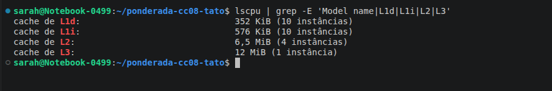
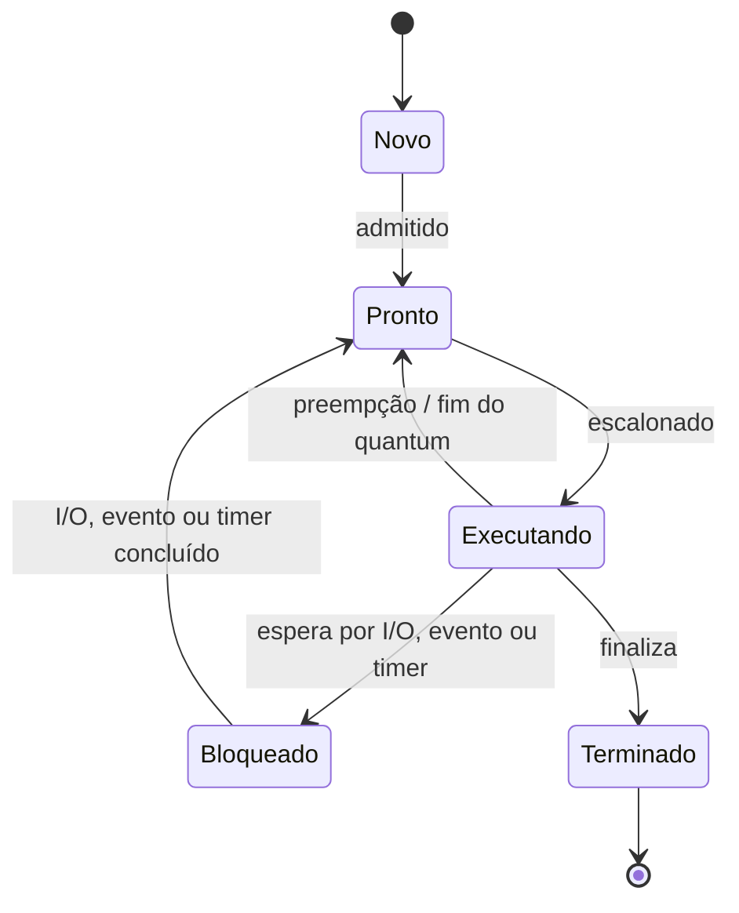
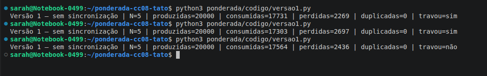
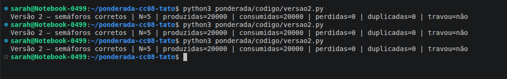
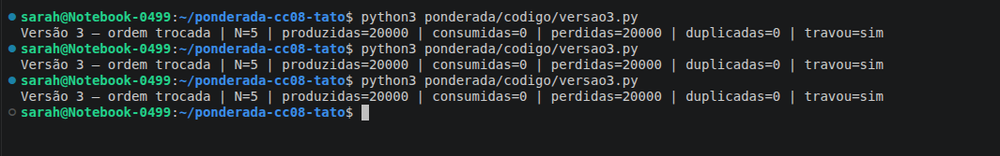

# Sarah Araujo Duarte — D1 = 5; D2 = 7; N = 5

Contagem individual: `Sarah` tem 5 letras, então **D1 = 5**. `Sarah` (5) + `Araujo` (6) + `Duarte` (6) = 17 letras; logo, **D2 = 7**. Assim, **N = 3 + (7 mod 5) = 5**.

# Parte A — O problema técnico

## A1. Arquitetura e memória: qual processador vai na pulseira?

### Parâmetros individuais

Quantidade de instruções por amostra:

\[
IC = 100.000 + 20.000 \times D2
   = 100.000 + 20.000 \times 7
   = 240.000\ \text{instruções}
\]

Taxa de falta da cache L1 da Plataforma V:

\[
m = 3\% + 0,5\% \times D1
  = 3\% + 0,5\% \times 5
  = 5,5\% = 0,055
\]

### Plataforma H

O tempo de CPU é dado por `instruções × CPI / clock`:

\[
T_H = \frac{240.000 \times 1,5}{48.000.000}
    = 0,0075\ \text{s}
    = 7,5\ \text{ms}
\]

**Conclusão:** a Plataforma H sem acelerador **não atende** ao limite de 5 ms; ela o excede em 2,5 ms.

### Plataforma V

Considerando um ciclo no acerto e penalidade de 120 ciclos por falta, o tempo médio de acesso à memória (AMAT) é:

\[
AMAT = 1 + m \times 120
     = 1 + 0,055 \times 120
     = 7,6\ \text{ciclos por acesso}
\]

Pela fórmula fornecida no enunciado:

\[
CPI_{efetivo} = 1,0 + (1,3 \times m \times 120)
              = 1,0 + (1,3 \times 0,055 \times 120)
              = 1,0 + 8,58
              = 9,58
\]

Tempo médio por amostra:

\[
T_V = \frac{240.000 \times 9,58}{1.200.000.000}
    = 0,001916\ \text{s}
    = 1,916\ \text{ms}
\]

No pior caso, soma-se a interrupção de até 3 ms do Linux:

\[
T_{V,pior} = 1,916 + 3 = 4,916\ \text{ms}
\]

**Conclusão:** a Plataforma V atende matematicamente aos 5 ms, mas sobra uma margem de apenas `5 − 4,916 = 0,084 ms` (84 µs). Essa margem é arriscada para um requisito de segurança.

### Plataforma H com DSP e Lei de Amdahl

O filtro representa 60% do tempo e é acelerado cinco vezes. O speedup global é:

\[
S = \frac{1}{(1-p)+\frac{p}{s}}
  = \frac{1}{(1-0,60)+\frac{0,60}{5}}
  = \frac{1}{0,40+0,12}
  = \frac{1}{0,52}
  \approx 1,923
\]

O novo tempo é:

\[
T_{H,DSP} = \frac{7,5}{1,923}
          = 3,9\ \text{ms}
\]

Outra forma de conferir é separar a parte não acelerada da acelerada: `7,5 × (0,40 + 0,60/5) = 3,9 ms`.

**Conclusão:** a Plataforma H com DSP **atende** ao requisito, com margem de 1,1 ms.

### Por que V precisa de cache e H funciona sem?

A Plataforma V compartilha o caminho para instruções e dados e usa DRAM muito mais lenta que o processador; sem cache, o gargalo de Von Neumann faria a CPU esperar a memória com frequência. A cache mantém instruções e dados recentes próximos da CPU. Já a H separa instruções e dados e usa SRAM interna de um ciclo, compatível com seu clock menor. Por isso ela não depende de cache para esconder a latência da memória.

### Evidência da máquina



A máquina possui L1 de dados (`L1d`, 352 KiB) separada da L1 de instruções (`L1i`, 576 KiB). Para o software, o x86-64 mantém um único espaço de endereçamento, característica de Von Neumann; internamente, porém, a L1 separada usa uma **Harvard modificada** para buscar instruções e acessar dados em paralelo. Logo, não é uma arquitetura Harvard pura.

## A2. Pipeline: o loop do filtro

### Dependências RAW

| Consumidora | Produtora | Registrador | Motivo |
|---|---|---:|---|
| I2 `add x6,x6,x5` | I1 `lw x5,0(x10)` | `x5` | I2 usa a amostra carregada por I1. |
| I4 `sub x6,x6,x7` | I2 `add x6,x6,x5` | `x6` | I4 usa a soma atualizada por I2. |
| I4 `sub x6,x6,x7` | I3 `lw x7,0(x11)` | `x7` | I4 usa a amostra antiga carregada por I3. |
| I5 `sw x6,0(x12)` | I4 `sub x6,x6,x7` | `x6` | I5 grava a soma produzida por I4. |

Essas são dependências verdadeiras de leitura após escrita (RAW). O uso inicial de `x6` por I2 vem de uma iteração anterior e, portanto, não cria uma nova dependência dentro deste trecho.

### Sem forwarding

`ID*` ou `IF*` indica que a instrução ficou retida naquele estágio por uma bolha. Como o registrador é escrito na primeira metade do ciclo e lido na segunda, uma consumidora pode terminar seu ID no mesmo ciclo do WB da produtora.

```text
Ciclo  01  02  03  04  05  06  07  08  09  10  11  12  13  14  15  16  17
I1     IF  ID  EX  MEM WB
I2         IF  ID  ID* ID* EX  MEM WB
I3             IF  IF* IF* ID  EX  MEM WB
I4                         IF  ID  ID* ID* EX  MEM WB
I5                             IF  IF* IF* ID  ID* ID* EX  MEM WB
I6                                         IF  IF* IF* ID  EX  MEM WB
I7                                                     IF  ID  EX  MEM WB
```

I2 precisa esperar o WB de I1; I4 espera o WB de I3 (e, até então, I2 já escreveu `x6`); I5 espera o WB de I4. O trecho leva **17 ciclos**, do primeiro IF ao último WB.

### Com forwarding

```text
Ciclo  01  02  03  04  05  06  07  08  09  10  11  12  13
I1     IF  ID  EX  MEM WB
I2         IF  ID  ID* EX  MEM WB
I3             IF  IF* ID  EX  MEM WB
I4                     IF  ID  ID* EX  MEM WB
I5                         IF  IF* ID  EX  MEM WB
I6                                 IF  ID  EX  MEM WB
I7                                     IF  ID  EX  MEM WB
```

O forwarding resolve as dependências entre operações aritméticas e também encaminha o dado a ser armazenado pelo `sw`. Restam duas bolhas de **load-use**: I1→I2 por `x5` e I3→I4 por `x7`. O valor de um `lw` só fica disponível ao final de MEM, tarde demais para a EX da instrução imediatamente seguinte. O trecho leva **13 ciclos**.

### Reordenação sem bolhas com forwarding

Uma ordem válida, preservando endereços e resultado, é:

```asm
1  lw   x5, 0(x10)     # lê a amostra nova
2  lw   x7, 0(x11)     # lê a amostra antiga enquanto x5 não está pronto
3  addi x10, x10, 4    # trabalho independente
4  add  x6, x6, x5     # soma += nova
5  addi x11, x11, 4    # separa add e sub; carga de x7 já terminou
6  sub  x6, x6, x7     # soma -= antiga
7  sw   x6, 0(x12)     # recebe x6 por forwarding
```

```text
Ciclo  01  02  03  04  05  06  07  08  09  10  11
J1     IF  ID  EX  MEM WB
J2         IF  ID  EX  MEM WB
J3             IF  ID  EX  MEM WB
J4                 IF  ID  EX  MEM WB
J5                     IF  ID  EX  MEM WB
J6                         IF  ID  EX  MEM WB
J7                             IF  ID  EX  MEM WB
```

Não há bolhas: o total é o mínimo ideal de `7 + 4 = 11 ciclos`.

## A3. Processos e threads: como organizar o software

### Proposta

Eu colocaria sensor, processamento e motor como três threads de um **processo principal**. As três tarefas trabalham em sequência e precisam trocar cada amostra rapidamente. Como são threads, elas podem usar o mesmo buffer na memória e têm um custo menor de criação e troca de contexto. O cuidado necessário é sincronizar o acesso ao buffer compartilhado.

O BLE ficaria em um **processo separado**, com apenas as permissões necessárias. Ele conversaria com o processo principal por uma fila de comunicação entre processos, também chamada de IPC. O processo principal enviaria cópias dos logs e aceitaria somente comandos validados. Essa comunicação tem um pequeno custo, mas o BLE não faz parte do caminho mais crítico, que é sensor→processamento→motor.

Se o BLE fosse uma thread e alguém explorasse uma falha nele, o invasor poderia acessar a mesma memória usada pelo sensor e pelo motor. Uma falha grave também poderia derrubar todo o processo. Como processo separado, o BLE tem sua própria área de memória e suas próprias permissões. Assim, ele pode falhar sem necessariamente interromper a vibração. Mesmo com essa separação, as mensagens recebidas pelo processo principal ainda precisam ser validadas.

### Estados de um processo



A thread do sensor passa a maior parte do tempo **bloqueada/esperando**, pois há uma amostra somente a cada 10 ms. Ela aguarda o timer ou a interrupção do sensor, é acordada, lê rapidamente a amostra e volta a esperar; espera bloqueada é preferível a desperdiçar CPU em espera ocupada.

## A4. Código com semáforos: o buffer entre o sensor e o motor

O parâmetro individual é:

\[
N = 3 + (D2 \bmod 5) = 3 + (7 \bmod 5) = 3 + 2 = 5
\]

O código está em [`codigo/`](codigo/). Cada versão foi executada três vezes com 20.000 amostras. “Consumidas” conta leituras válidas; “perdidas” conta IDs esperados que nunca chegaram; “duplicadas” conta ocorrências válidas além da primeira.

| Versão | Execução | Consumidas | Perdidas | Duplicadas | Travou? |
|---|---:|---:|---:|---:|:---:|
| 1 — sem sincronização | 1 | 17.901 | 2.099 | 0 | Não |
| 1 — sem sincronização | 2 | 17.536 | 2.464 | 0 | Sim |
| 1 — sem sincronização | 3 | 17.813 | 2.187 | 0 | Sim |
| 2 — semáforos corretos | 1 | 20.000 | 0 | 0 | Não |
| 2 — semáforos corretos | 2 | 20.000 | 0 | 0 | Não |
| 2 — semáforos corretos | 3 | 20.000 | 0 | 0 | Não |
| 3 — ordem trocada | 1 | 0 | 20.000 | 0 | Sim |
| 3 — ordem trocada | 2 | 0 | 20.000 | 0 | Sim |
| 3 — ordem trocada | 3 | 0 | 20.000 | 0 | Sim |

### Prints das execuções







### Análise da versão 1

A região crítica é o trecho que verifica `ocupadas`, acessa o buffer, avança o índice e atualiza o contador. A operação `ocupadas = ocupadas ± 1` não acontece de uma vez: primeiro a thread lê o valor e depois grava o resultado. O `sleep(0)` permite uma troca de thread entre essas duas etapas. As duas threads podem ler o mesmo valor e uma escrita acaba apagando o resultado da outra. Com isso, o contador deixa de representar o conteúdo real do buffer. Uma amostra pode ser sobrescrita antes do consumo, lida mais de uma vez ou as threads podem ficar sem progresso. Nas três execuções houve perdas e duas chegaram ao timeout. Não apareceram duplicações nessas rodadas, mas o resultado pode mudar conforme o escalonamento das threads.

### O que garante cada semáforo na versão 2

- `vazio`, iniciado em N = 5, conta vagas livres. O produtor só insere depois de obter uma vaga e o consumidor devolve uma vaga após retirar.
- `cheio`, iniciado em 0, conta itens disponíveis. O consumidor só retira depois de obter um item e o produtor sinaliza após inserir.
- `mutex`, iniciado em 1, dá exclusão mútua sobre buffer, índices e atualização do estado compartilhado.

A ordem segura é esperar `vazio`/`cheio` **antes** de obter o `mutex`, de modo que nenhuma thread durma esperando uma condição do buffer enquanto bloqueia o acesso necessário para a outra thread mudar essa condição.

### O que aconteceu na versão 3

O produtor obteve `mutex`, encheu as cinco posições e, na tentativa seguinte, manteve `mutex` enquanto esperava `vazio`. O consumidor obteve `cheio`, mas não conseguiu obter `mutex` para remover um item e liberar `vazio`. Portanto, produtor e consumidor ficaram esperando um ao outro. O watchdog registrou travamento após um segundo nas três execuções.

## A5. Deadlock: a pulseira congelou

### Sequência que leva ao deadlock

1. `thread_sensor` executa `P(i2c)` e passa a possuir o barramento I2C.
2. Antes de obter `log`, ela é interrompida; `thread_log` executa `P(log)` e passa a possuir o arquivo de log.
3. `thread_config` executa `P(ble)` e passa a possuir o rádio BLE.
4. `thread_sensor` volta e bloqueia em `P(log)`, pois `thread_log` possui `log`.
5. `thread_log` bloqueia em `P(ble)`, pois `thread_config` possui `ble`.
6. `thread_config` bloqueia em `P(i2c)`, pois `thread_sensor` possui `i2c`.

### Grafo de alocação de recursos

Uma seta `recurso → thread` representa alocação; `thread → recurso` representa solicitação.


O ciclo `i2c → sensor → log → thread_log → ble → thread_config → i2c` comprova a espera circular.

### As quatro condições necessárias

1. **Exclusão mútua:** cada semáforo permite que apenas uma thread use I2C, log ou BLE por vez.
2. **Posse e espera:** cada thread mantém um recurso enquanto pede o segundo: sensor mantém I2C, log mantém log e config mantém BLE.
3. **Não preempção:** nenhum recurso é retirado à força; apenas a thread proprietária executa `V`.
4. **Espera circular:** sensor espera log, log espera BLE e config espera I2C, fechando o ciclo.

### Duas correções

**1. Prevenção com uma ordem única.** Pode-se definir a ordem `i2c < log < ble` e obrigar todas as threads a seguir essa ordem ao pedir mais de um recurso. A `thread_config`, por exemplo, deve obter I2C antes de BLE. Outra opção é copiar o comando, liberar BLE e só depois obter I2C. Dessa forma, o ciclo de espera deixa de existir. Para quem usa a pulseira, a vantagem é evitar o congelamento. O custo pode ser um pequeno atraso na configuração ou no envio de logs, que são menos críticos que a vibração.

**2. Detecção e recuperação por timeout.** A thread pode esperar o segundo semáforo somente por um tempo limitado. Se esse tempo acabar, ela registra o problema, libera o primeiro recurso e tenta novamente depois de uma pequena espera. Um monitor também pode reiniciar somente o módulo que falhou. Para quem usa a pulseira, um log pode atrasar ou um comando pode precisar ser enviado de novo, mas a vibração continua funcionando. Essa solução exige testes para garantir que nenhuma operação fique pela metade.

# Parte B — A decisão do CTO

## Memorando ao conselho — Dilema 2: processador de produção

**Decido produzir a pulseira com a Plataforma H e o acelerador DSP.** Essa opção custa R$ 37 por unidade, enquanto a Plataforma V custa R$ 70. Em 2.000 unidades, a diferença é de R$ 66.000. Mais importante que o preço é o tempo de resposta: a H com DSP processa cada amostra em 3,9 ms e fica 1,1 ms abaixo do limite de 5 ms. Ela também não tem um sistema operacional que possa interromper a tarefa no momento errado.

Ao escolher a H, estou abrindo mão das atualizações pela internet. Para atualizar o firmware, a pulseira terá que ser levada à assistência técnica e conectada por cabo. A empresa terá custos de atendimento e logística, e a pessoa usuária poderá ficar um tempo sem o produto. Também será mais difícil adicionar novas funções. Para diminuir esse problema, o firmware deve ser muito bem testado antes da fabricação e a empresa deve oferecer uma troca rápida em atualizações importantes.

A Plataforma V é mais rápida na média, com 1,916 ms por amostra. O problema aparece no pior caso: com a interrupção de até 3 ms do Linux, o tempo chega a **4,916 ms**. A margem é de apenas 0,084 ms. Isso é muito pouco para um produto de segurança. Além disso, Linux e atualização pela internet aumentam os pontos que podem ser atacados. A Plataforma H tem um software menor e mais simples de verificar. Mesmo assim, ela ainda precisa de inicialização segura, firmware assinado e proteção da conexão física.

Para quem usa a pulseira, a principal vantagem é ter uma resposta mais previsível e menor risco de ficar sem vibração diante de um obstáculo. A desvantagem é que correções de software chegarão mais devagar. Se surgir uma falha grave, a empresa deverá avisar os usuários e organizar a atualização ou troca das pulseiras rapidamente.

Eu mudaria de ideia se a Plataforma V, usando um Linux de tempo real, BLE ativo e carga máxima, processasse pelo menos 10 milhões de amostras sem perdas e nunca passasse de **4,0 ms**. Também seria necessário comprovar que a inicialização e as atualizações pela internet são seguras. Nesse caso, haveria uma margem real de 1 ms e a atualização remota poderia compensar o preço e a complexidade maiores.
